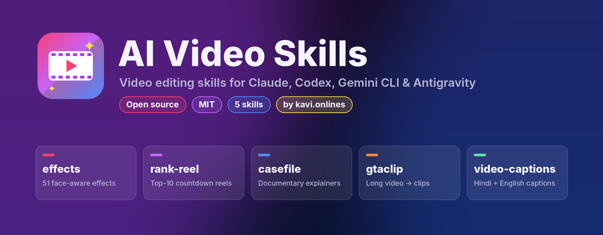

<p align="center">
  
</p>

<p align="center">
  <a href="LICENSE"></a>
  
  
</p>

<p align="center">
  <b>5 video-editing skills you can drop into any AI agent.</b><br>
  Face-aware effects, countdown reels, documentary explainers, long-video clipping and Hindi + English captions.<br>
  Works with <b>Claude</b> (Claude.ai + Claude Code), <b>OpenAI Codex</b>, <b>Gemini CLI</b> and <b>Google Antigravity</b>, with any model.
</p>

---

## 🎬 The skills

| Skill | What it makes | Needs |
|---|---|---|
| [`effects`](.agents/skills/effects/SKILL.md) | Adds any of **51 effects** to a talking-head video: orbit, spotlight, glass widgets, checklist, LED sign, match-cut, iMessage pop-ups and more. Effects track your face and can sit **behind your head**. | Python 3.12, ffmpeg |
| [`rank-reel`](.agents/skills/rank-reel/SKILL.md) | A **Hindi Top 10 → No.1 countdown reel** with bright cards, counting numbers, demo panels, word-by-word Devanagari captions and a "comment" outro. From a topic or your own video. | Node.js, HyperFrames, Chrome |
| [`casefile-documentary-reel`](.agents/skills/casefile-documentary-reel/SKILL.md) | A **case-file documentary explainer** on any topic: aged notebook paper, bold headlines, red-ink circles, stamps, typewriter documents. | Node.js, HyperFrames, Chrome |
| [`gtaclip`](.agents/skills/gtaclip/SKILL.md) | Turns a **long YouTube video into viral 9:16 clips** with a hook title and captions. The agent picks the moments, no API key. Uses [GTAClip](https://github.com/kavitarak/GTA-clip.kavi). | Python 3.10, ffmpeg, yt-dlp |
| [`video-captions`](.agents/skills/video-captions/SKILL.md) | Burns **Hindi/Hinglish + English captions** and a credit line into any video, writes `.srt` files and Hinglish hooks. Whisper runs offline. Uses [Video Caption Generator](https://github.com/kavitarak/video-caption-generator-by-tarak-industries). | Python 3.10, ffmpeg |

The agent installs what's missing the first time. You just ask.

---

## 🚀 Install

```bash
git clone https://github.com/kavitarak/ai-video-skills.git
cd ai-video-skills
```

Then pick your tool:

### Claude Code

```bash
bash install.sh claude                      # macOS / Linux
powershell -ExecutionPolicy Bypass -File install.ps1 claude    # Windows
```

Skills go to `~/.claude/skills/`. Restart Claude Code, then type `/effects` or just ask.

### Claude.ai (web, desktop, mobile)

1. Open the [`dist/`](dist) folder and download the `.zip` for each skill you want.
2. In Claude, open **Settings**, find **Skills** (under Capabilities or Customize, depending on your app version) and upload the zip.
3. Ask: *"Add the spotlight effect to my video"*.

### OpenAI Codex

```bash
bash install.sh codex                       # or: install.ps1 codex
```

Skills go to `~/.codex/skills/`. Restart Codex, then type `$` to pick a skill, or just ask.

### Gemini CLI

```bash
bash install.sh gemini                      # or: install.ps1 gemini
```

Skills go to `~/.gemini/skills/`. Check with `/skills list`.

### Google Antigravity

```bash
bash install.sh antigravity                 # or: install.ps1 antigravity
```

Skills go to `~/.gemini/config/skills/`. Restart Antigravity, then type `/<skill-name>` in the agent panel or just ask.

### All tools at once

```bash
bash install.sh                             # macOS / Linux
powershell -ExecutionPolicy Bypass -File install.ps1           # Windows
```

> **No install needed inside this folder:** Codex, Gemini CLI and Antigravity read `.agents/skills/` and Claude Code reads `.claude/skills/` when you open this repo directly.

---

## 💬 Example prompts

```text
/effects spotlight on the word "free" in my_video.mp4
Make a rank reel: top 5 free AI tools for students
Make a casefile documentary reel about how UPI changed India
Clip this podcast into 5 Shorts: https://youtu.be/VIDEO_ID
Add Hindi and English captions to my_video.mp4 with credit "Video by Tarak Industries"
```

> 🇮🇳 Hinglish mein bhi chalega: *"is video mein spotlight effect lagao"*, *"is video par Hindi aur English captions daalo"*

---

## 🧑‍💻 Contributing

1. Edit a skill in `.agents/skills/<name>/SKILL.md` (this is the only copy you edit).
2. Run `python scripts/build.py`. It checks every skill, syncs `.claude/skills/` and rebuilds `dist/*.zip`.
3. Run `python -m unittest discover -s tests`.
4. Open a pull request.

A skill is a folder with a `SKILL.md` that starts with:

```yaml
---
name: my-skill            # same as the folder name, lowercase-with-hyphens
description: What it does and when to use it.
---
```

---

## ⚖️ Use responsibly

Only edit, clip or caption videos you own or have permission to use. Don't put real people's photos into videos without their consent. Always watch a render before posting.

---

## 📜 License

<table>
<tr>
<td width="90" align="center"></td>
<td>

**MIT License.** Free for personal and commercial use. Copy, modify and share; just keep the copyright notice. See [LICENSE](LICENSE).

The `effects` skill is adapted from [claude-video-effects](https://github.com/Vibha-Ramprakash/claude-video-effects) by **Vibha Ramprakash** (@vibha.in.progress), MIT. Its license stays in [`.agents/skills/effects/LICENSE`](.agents/skills/effects/LICENSE). Other tools are listed in [THIRD_PARTY_NOTICES.md](THIRD_PARTY_NOTICES.md).

<sub>Copyright © 2026 Hemant Tarak (kavi.onlines) · Tarak Industries</sub>

</td>
</tr>
</table>

---

<p align="center">
  Made with ❤️ by <b>kavi.onlines</b> (Kavi Tarak)<br>
  <a href="https://www.youtube.com/@kavi.online">YouTube</a> ·
  <a href="https://t.me/kavitarak">Telegram</a> ·
  <a href="https://linkedin.com/in/hemanttarak">LinkedIn</a><br>
  <sub>⭐ Star this repo if it helped you!</sub>
</p>
